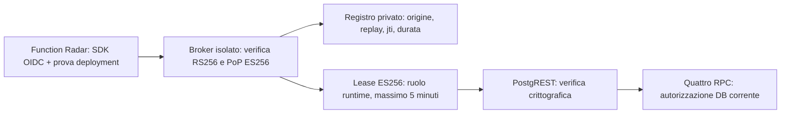

# Radar Patrimoniale — identità runtime e rinnovo OIDC, Fase 5B.4

26 ottobre 2026. **Rinnovo implementato e verificato localmente; NO-GO per il collaudo remoto identificato e per il pubblico.** Il runtime non dipende più dalla sostituzione di un JWT Supabase nelle env a ogni scadenza. Il broker, la sua autorità Supabase e il provisioning della prova del deployment non sono installati né autorizzati sul remoto. Non dichiariamo operativa la rotazione Vercel/Supabase.

## Baseline, perimetro e SHA locali

Letti AGENTS.md, DESIGN.md, guide Next 16.3.5 installate, istruzioni Hub, [report completo 5B.3](radar-patrimoniale-fase-5b3-operational-preflight.md) e [manifest precedente](operational-5b3-evidence/manifest-operativo.md). Consultate le skill Supabase e Vercel pertinenti. Nessuna modifica a questionario, motore 4A, UI, funnel, P1 o progettazione Hub.

| Repository | HEAD iniziale verificato | Commit locali 5B.4 / HEAD codice |
| --- | --- | --- |
| Website | **0bf7c32b0380879284a0836d46ab6a9b04c41f4f**, sopra codice ce9b47c7b050126c8e982f883908d6da703cce80 | 2d1d0a7cb4071f86ea4b32282b370c3607c323ec; **28a96f998ad343b388b6aaab29f2560b8bb67ca6** precisa il commento sulle chiavi |
| Platform | **6439bc0e94a60abf327dc335ab24d016d4db68fd** | bdf1beafa5de60c26b615ba4bfd7e2d53f2a4de3; **c421f88fbff27a1837eee157cfba337f61facc2a** impone TLS verificato |
| Hub | **39ff38b82c4a03efb4dd530b0dd47093bae25510** | invariato |

Il commit documentale Website successivo è indicato nella consegna, evitando un autoriferimento. Worktree nuovi, branch **codex/radar-runtime-oidc-5b4** in ciascun repository:

`C:/Users/emanu/.codex/visualizations/2026/10/18/01a14e5a-6067-71a0-a210-f3859cab8329/fase-5b4/{website,platform,hub}`

[Preservazione](runtime-identity-5b4-evidence/preservation-result.json): otto workspace precedenti invariati per HEAD, branch, diff, file non tracciati non ignorati e lock osservati; inclusi **2772 file non tracciati Website** e il lavoro sulle assegnazioni. Nessun reset, clean, stash o commit del lavoro concorrente; lock Hub/Platform storici conservati. Nessun processo Git concorrente osservato prima dei commit dedicati. I test usano cartelle/dati nuovi; alcune dipendenze sono riutilizzate tramite junction. Le cache ignorate dei tool non sono incluse nel confronto di preservazione e non vengono certificate byte per byte.

[Inventario](runtime-identity-5b4-evidence/code-inventory.json): 14 file Website di codice/test/dependency/pin e 11 Platform, di cui una candidate SQL e un servizio separato. Nessun file Hub modificato. Nessun merge o integrazione di main più recenti è implicitamente certificato.

## 1. Autorità OIDC: fatti verificati e limiti

Fonti ufficiali correnti: [OIDC](https://vercel.com/docs/oidc), [API e audience](https://vercel.com/docs/oidc/api), [reference claim](https://vercel.com/docs/oidc/reference), [custom audience](https://vercel.com/changelog/custom-oidc-token-audiences). Non è stata letta o richiesta una credenziale reale.

| Dato | Riscontro / uso |
| --- | --- |
| Issuer team | **https://oidc.vercel.com/horyzon-consulting**, discovery pubblica letta il 26/10 alle 09:30 UTC |
| JWKS | **https://oidc.vercel.com/horyzon-consulting/.well-known/jwks**; due kid pubblici, RSA/RS256, coerenti con discovery |
| Owner | contratto atteso horyzon-consulting / **team_LsT2CKLXy6aIHfeH9SPKpDIz** |
| Project | contratto atteso horyzon-radar-pilot / **prj_bJvIOswh4GacqtUootXATXeAkSUO** |
| Environment / subject | **preview** / `owner:horyzon-consulting:project:horyzon-radar-pilot:environment:preview` |
| Audience | si richiede **<issuer HTTPS del broker>/v1/lease**; audience generica del team o array alternativo rifiutati |
| Durata documentata | Functions: token fino a 2 ore, riuso fino a 90 minuti; build 1 ora, sviluppo 12 ore. Il broker accetta solo Preview e durata OIDC massima 7200s |
| Deployment esatto | **nessuna claim deployment_id documentata**. Non si presume un claim supplementare; ID, URL, body e env da soli non costituiscono prova |
| Prova runtime reale | **NOT RUN**: nessuna Function 5B.4 distribuita, nessun token remoto ispezionato, nessuno scambio custom-audience reale effettuato |

[Metadati pubblici effettivi](runtime-identity-5b4-evidence/oidc-public-metadata.json). Owner/project/subject/durata sono contratto ufficiale e pin del codice, esercitati con firme sintetiche; non sono claim osservate oggi da una Function reale. La lettura Vercel/Supabase autenticata della 5B.3 rimane storica, non ricertificata al 26/10.

Installati esattamente **@vercel/oidc 4.0.0** e **jose 6.2.12**, lockfile incluso. Ispezionati getter, tipi e scambio del pacchetto installato: request context → file rotante → env; file configurato vuoto/non leggibile fallisce senza ripiegare sull'env. Il getter non va memorizzato come token fisso. La factory usa `getVercelOidcToken({audience,skipCache:true,expirationBufferMs:30000})` a ogni scambio. I test leggono davvero due token sintetici successivi dal file dell'SDK e verificano i dinieghi; non chiamano l'exchange Vercel. Versione/source/integrity di **tutti i pacchetti preesistenti** risultano conservate; le differenze dev/optional del lock sono riclassificazioni npm, non aggiornamenti di versione.

Consultato anche il [changelog Supabase](https://supabase.com/changelog): deprecazione CBC TLS, minor PostgreSQL 15.19/17.11 e requisiti Node correnti. Il broker usa Node >=22.18 e verifica il certificato TLS del DB; nessun downgrade `rejectUnauthorized:false`. Il clone nativo è PostgreSQL17.6, non una certificazione del patch level o della configurazione attuale del servizio Supabase.

## 2. Architettura implementata



Il broker è in **Platform/services/radar-credential-broker**, servizio Node autonomo, fuori dal workspace pnpm e dai deployment config Website/Hub/shared API. Il progetto Vercel pilota non contiene il firmatario Supabase. Il listener è loopback dietro un futuro ingresso HTTPS approvato. HTTP/discovery/JWKS, verifier JOSE, signer e store SQL ristretto sono implementati; nessuna infrastruttura è stata creata.

Sono state valutate Edge Functions e autenticazione esterna diretta: nessuna autorità di firma/mapping remoto dimostrata rende Edge una scorciatoia; il servizio isolato consente test nativi e un confine esplicito. [Supabase Custom OIDC](https://supabase.com/docs/guides/auth/third-party/custom-oidc) richiede integrazione dell'issuer HTTPS, discovery/JWKS, firma asimmetrica con kid e claim role. Non è una configurazione CLI né un'accettazione automatica dei JWT Vercel. Il broker resta necessario per registrazione, revoca, ruolo e prova dell'origine.

Si propone una chiave **ES256 dedicata del broker**, senza usare il segreto HMAC globale Supabase. Il test PostgREST locale usa un JWKS sintetico ES256 per il broker e una chiave HS256 sintetica separata per le prove staff storiche. Questo prova il verifier crittografico e il ruolo PostgreSQL, **non** l'integrazione Third-Party Auth del gateway reale.

## 3. Deployment esatto: credenziale indipendente, gate ancora chiuso

OIDC attesta progetto/ambiente; non distingue due Preview dello stesso progetto. Un GET dei metadati Vercel per un ID dichiarato dal chiamante confermerebbe l'esistenza dell'artefatto, non la provenienza della richiesta. Non viene utilizzato come scorciatoia.

Il secondo fattore implementato è **proof of possession ES256**, con chiave diversa per ogni deployment. Un provisioner CI/DBA fidato, esterno al pilota, deve:

1. Generare origin UUID e chiave del solo futuro deployment; custodire la privata e consegnarla esclusivamente al runtime di quell'artefatto. La [CLI documenta env runtime distinte dalle build env](https://vercel.com/docs/cli/deploy#env); la consegna sicura effettiva va ancora collaudata, senza valori in argv/log/artefatti/client bundle.
2. Verificare via metadati Vercel il deployment restituito, team/project, target Preview effettivo, URL generato e SHA approvato; registrare la sola JWK pubblica con ID, origine, SHA, scadenza e riferimento di approvazione. Fino alla registrazione, nessuna lease utilizzabile.
3. Non mettere la privata in Shared/project-wide/Production/build env, Git, browser o un deployment successivo. Un nuovo deployment richiede nuova chiave e nuova registrazione. Il DB proibisce riuso delle coordinate della chiave e modifica dei dati di un'origine già registrata.

Non è attestazione hardware né una claim Vercel inventata: la sicurezza del binding dipende dal provisioner e dalla custodia esclusiva di questa **credenziale secondaria di deployment**. Una copia della privata comprometterebbe tale distinzione e richiederebbe revoca immediata. Il solo origin UUID è un selettore pubblico, non un segreto autorizzativo.

**Provisioner, autorità di registrazione e custodia reali non disponibili/approvati: gate chiuso.** La Preview esistente non è stata modificata. Se non si può garantire consegna per artefatto e impedirne il riuso, non attivare il percorso: serve una diversa attestazione indipendente e verificabile, oppure un workload isolato con identità dedicata per singola istanza approvata, da progettare/collaudare con nuova autorizzazione. Nessuna allowlist di URL sostituisce questo requisito.

## 4. Contratto, emissione, rinnovo e revoca

`POST <broker>/v1/lease`, Authorization Bearer OIDC custom-audience, JSON chiuso:

```json
{"originId":"<UUID registrato>","instanceId":"<UUID processo>","previousTokenId":null,"proof":"<JWT ES256>"}
```

PoP: sub=origin UUID, aud/htu=endpoint esatto, htm=POST, iat/nbf/exp massimo30s, jti UUID monouso, ath=SHA256 base64url dell'OIDC; anche originId/instanceId/previousTokenId sono firmati. Parametri arbitrari di ruolo/ref/TTL/deployment rifiutati. Il broker valida firma, issuer/aud/sub, owner/project ID e nomi, environment, timestamp e origine corrente. JWKS OIDC fissato nel codice, mai ricavato da un token non verificato.

Firma una lease con ruolo **patrimonial_radar_runtime**, ref **pmkyeqrfkunypfkbjnyg**, issuer broker, aud authenticated, origin_id, deployment_id dal registro, jti nuovo, iat/nbf/exp. Durata **min(300s, scadenza OIDC, scadenza origine)**. Poi registra atomicamente sotto lock di origine: replay, slot/precedente, jti, expiry, autorizzazione e audit. **Restituisce il token solo dopo commit.** Se DB/firma falliscono, nessun token consegnato; anche un token validamente firmato ma non registrato è negato da ogni RPC.

RemoteRadarRpc ottiene una credenziale asincrona prima di ogni chiamata. Cache soltanto in memoria della lease, rinnovo quando restano60s, single-flight nel processo; processi distinti hanno slot distinti. OIDC viene riletto dall'SDK a ogni scambio, mai conservato come credenziale statica. Il precedente jti ha overlap massimo30s nel DB; una revoca esplicita non attende tale overlap.

Rinnovo fallito → cache scartata e **503**, anche se il vecchio JWT sarebbe ancora temporalmente valido. Nessun fallback a `PATRIMONIAL_RADAR_RUNTIME_TOKEN`, service-role o token scaduto. Una lease ancora valida nella cache può operare fino al momento del rinnovo, sempre soggetta al DB; non si presume una chiamata di liveness all'issuer per ogni cache hit. Una risposta persa dopo commit crea al massimo una lease orfana breve: il client riparte con un nuovo slot provato, senza ripetere alla cieca il CAS ambiguo. Limite32 slot attivi per origine, errore chiuso se esauriti; capacità/autoscaling richiedono review prima dell'esercizio continuativo.

Revoca jti: `runtime_deployments.revoked_at`; revoca intera origine: `runtime_origins.revoked_at`. Ogni RPC controlla firma all'ingresso e **origine corrente, issuer, deployment, jti, ref, expiry e revoca nel DB**, con lock coerenti rispetto all'emissione/revoca. Niente riattivazione dell'origine; nuova approvazione → nuova origine e chiave. Le operazioni di revoca sono del DBA autorizzato, non del browser o broker. L'audit registra solo ID opachi, tempo ed esito; nessun JWT/OIDC/PoP, body, email o dato patrimoniale. Log HTTP/proxy devono essere configurati senza header/body; retention tecnica da approvare.

L'eventuale `runtimeToken` esplicitamente iniettato nel costruttore resta solo per i verificatori storici. La factory di produzione non legge quella env e non lo usa come riserva. La candidate 5B.4 nega anche le vecchie autorizzazioni senza origin_id.

## 5. Privilegi e candidate

**Platform/packages/database/pending/20261026091550_patrimonial_runtime_oidc_broker_candidate.sql**, filename generato con Supabase CLI2.121.0, applicato solo al DB sintetico.

- Richiede intake5B.3; aggiunge runtime_origins, runtime_lease_slots, runtime_exchange_replays e runtime_issuer_audit nello schema privato; RLS/FORCE, nessun table grant applicativo.
- Aggiunge origin_id nullable a runtime_deployments, senza backfill; sostituisce il solo runtime_allowed mantenendo i gate per operazione.
- Ruolo **patrimonial_radar_issuer NOLOGIN/NOINHERIT/NOBYPASSRLS**, USAGE privato e **solo due EXECUTE privati**: broker_origin e broker_register. Non è membro di authenticator; nessun login/secret reale creato.
- Nessuna RPC pubblica nuova. Restano le quattro applicative approvate: runtime_health, runtime_command, runtime_foundation, runtime_event, con prefisso patrimonial_radar_. Nessun ledger generico o endpoint tabellare.
- Nel clone canonico due accessor INVOKER preesistenti `app_user_id/app_tenant_id`, funzioni pgcrypto e trigger ereditano PUBLIC. I test distinguono questi oggetti dalle quattro RPC applicative, controllano che gli accessor leggano solo current_setting e verificano il diniego ai dati. Nessun REVOKE globale che alteri altri sistemi. Ripetere l'inventario ACL sul vero catalogo prima del GO.
- Registro origine immutabile salvo revoca; audit append-only; proof key non riusabile; replay concorrente e CAS serializzati; niente grant nominativi/admin o configurazione remota incorporati nella SQL.

Il login futuro del broker deve ereditare soltanto issuer, senza superuser/bypass/service-role/authenticator: startup controlla queste condizioni, usa TLS verificato e query fisse. Il test nativo usa un bridge pg con SET ROLE per esercitare le stesse due funzioni; **non testa la futura connessione TLS del driver postgres.js a Supabase**.

Un nuovo issuer è un'autorità sensibile sul progetto Supabase condiviso: la sola limitazione del login SQL del broker non limita una chiave di firma compromessa. Prima del GO occorre approvare custodia/isolamento della chiave e dimostrare mapping del solo ruolo previsto e dinieghi di elevazione nel gateway reale. Non si presume che Third-Party Auth faccia questa limitazione automaticamente. Propagazione JWKS/rollover e mantenimento delle sole chiavi pubbliche precedenti richiedono una procedura verificata distinta dal rinnovo ordinario delle lease.

## 6. Verifiche realmente eseguite

| Prova | Esito / evidenza |
| --- | --- |
| OIDC + PoP + firma lease ES256, PostgreSQL17.6/PostgREST16.5 nativi, percorso completo | **19 gruppi PASS**, [log](runtime-identity-5b4-evidence/oidc-native.txt) |
| Rinnovo durante compilazione e dopo report/P1 | PASS: jti nuovo, overlap limitato, hash/conteggi identici su **nove tabelle business**, lettura cliente e Advisor mantenute |
| Due processi OS concorrenti | PASS: processi Node separati → broker loopback comune → registrazione DB → jti distinti; anche single-flight e replay concorrente |
| Clock sintetico del broker, TTL, expiry OIDC, rinnovo e recupero | **4 test crittografici PASS**; più test HTTP reale loopback: **5/5 totali**, [log](runtime-identity-5b4-evidence/broker-tests.txt) |
| SDK4 e factory / lockfile | PASS: file OIDC aggiornato/assente/vuoto, nessun env fallback, nessun vecchio token factory; tutte le versioni/integrity precedenti immutate, [log](runtime-identity-5b4-evidence/runtime-sdk-tests.txt) |
| Attivazione storica5B.2, sessioni/OTP/staff/permessi | **12 gruppi PASS** nativi, [log](runtime-identity-5b4-evidence/activation-native.txt) |
| Backend cliente/OTP/persistenza/HTTP | **14 gruppi PASS** PostgreSQL WASM/PGlite, distinto dal nativo, [log](runtime-identity-5b4-evidence/backend-regression.txt) |
| Regressioni Website | **19 suite PASS**, inclusi motore, Advisor, UI/public, ledger, CRM, opportunità, persistenza, mapping, funnel, Evento/Architetto, Radar v4 e preservazione; [exit code](runtime-identity-5b4-evidence/regressions.json) |
| Website typecheck/build/lint | **PASS/PASS/PASS**, lint0 errori/76 warning ereditati |
| Broker typecheck/lint | **PASS/PASS**, nessun errore lint |
| Hub test/build | **197 PASS, 0 FAIL / PASS**, codice invariato |
| Hub typecheck/lint | **FAIL:79 errori TS / 348 errori e14 warning lint**, ereditati; confronto diagnostico con5B.3 nelle [evidenze](runtime-identity-5b4-evidence/results.json) |
| Platform database | **30 PASS in7 file**, database effimeri sul solo cluster loopback |
| Browser, OTP effettivo, exchange OIDC reale, broker remoto, Supabase Custom OIDC/Trusted Sources | **NOT RUN**; nessun nuovo artefatto remoto e nessuna UI modificata |
| ETag HTML304 | **FAIL storico APERTO**, non ritestato/risolto; [ticket esistente](operational-5b3-evidence/vercel-ticket-addendum.md) non inviato |

Negativi nativi: progetto/nome/owner/subject/audience errati, Production, JWT scaduto/nbf futuro/firma errata, origine sconosciuta, origine nota con nuova chiave non approvata, ID/deployment arbitrari, PoP alterata/replay, firma valida senza registrazione, DB lease scaduta, revoca singola e origine, riattivazione/modifica origine e riuso chiave, accessi tabellari/generici, assenza di membership issuer nell'authenticator. Indisponibilità rete/JWKS/registrazione e risposta persa negano senza fallback; successivo recupero verificato. Una JWKS già valida in cache può verificare chiavi note; l'indisponibilità non trasforma un token non verificabile in autorizzato.

Le lease native sono abbreviate a65s, limite interno al broker sintetico; si attende realmente l'ingresso nella finestra di rinnovo. I test clock separati esercitano la durata standard300s e OIDC oltre7200s. Non sono state allentate finestre temporali per far passare una prova futura. PostgreSQL17.6 non replica GoTrue o l'intero gateway Supabase.

Gli assert di preservazione sono rimasti attivi, inclusa la prova di modifica SQL rifiutata. Aggiornati **solo otto pin espliciti** del confine credenziali/dipendenze dopo review e test; l'assert UI ammette esattamente SDK4 e JOSE, conservando ogni dipendenza storica. Nessun baseline di UI rilassato. **Radar d'Impresa v4 con34 schermate, entrambi i funnel e35 asset fotografici preservati.** Test statici/build non sostituiscono un controllo browser.

Comando ripetibile del collaudo OIDC, dalla Website con PostgreSQL/PostgREST sintetici già in ascolto su127.0.0.1:15439/15440 e relativo JWKS/config locale (mai config reale):

```text
node --no-warnings --experimental-strip-types scripts/verify-patrimonial-network-clienti.mjs --operational-preflight --activation-candidate --oidc-broker --network-platform=../platform --pg-module=../../fase-5a/tools/node_modules/pg/lib/index.js --local-config=../tools/local-test-access.json
node --no-warnings --experimental-strip-types scripts/verify-patrimonial-runtime-credential.mjs
```

I percorsi relativi corrispondono ai worktree isolati consegnati. Il verificatore richiede esplicitamente il database radar_5a_test e le porte loopback; non consente un fallback remoto. Nel servizio broker: `npm run typecheck`, `npm test`; il secondo apre soltanto un server di test loopback. Le suite che reimpostano lo schema Radar vanno eseguite in sequenza.

Platform full monorepo build/typecheck non rieseguiti: nuovo servizio autonomo verificato separatamente; package database e replay nativo verificati. Nessun risultato di fasi precedenti contato come eseguito oggi. I fallimenti iniziali di setup (DLL/permessi loopback/junction, cache schema e doppia applicazione nel verificatore storico) sono stati corretti e le prove rilanciate; gli esiti allegati sono delle esecuzioni finali. Nei log allegati sono normalizzati solo terminatori, spazi di fine riga e righe vuote finali. Output originali conservati nella cartella fase-5b4 fuori Git; nessuna chiave/config sintetica allegata.

## 7. Manifest remoto finale — preparato, NON eseguito

Questo ordine sostituisce **solo la parte tecnica runtime** delle ipotesi5B.3 (token env/lease manuale30–45min). Conserva privacy, email, staff, backup, P1 e protezioni del manifest precedente. Ogni scrittura richiede nuova autorizzazione esplicita; nessun PASS locale la implica.

Destinazioni fisse: Supabase **pmkyeqrfkunypfkbjnyg**; Vercel **horyzon-consulting/team_LsT2CKLXy6aIHfeH9SPKpDIz**; pilota **prj_bJvIOswh4GacqtUootXATXeAkSUO**; futuro Hub Preview **prj_RltJaUziQT9bOGVwWQueRb2KfEjv**. **Issuer/hosting broker: da nominare e approvare, oggi assente.** Conservare entrambi gli artefatti precedenti, incluso dpl_WHyLB43axP3D8H9MSqNGEYFRzdxj, senza modificarli. Nessun horyzon.it, horyzon-website Production o GitHub/main.

| Ordine | Passo futuro esatto | Punto di arresto |
| --- | --- | --- |
| 0 | Approvare bundle/SHA, referente/DBA, identità staff/email, privacy/retention, finestra, budget e presidio consegna. | Mancanza anche di un'approvazione nominativa. RP-SERVICE-5A-DRAFT-1 resta bozza |
| 1 | Deliberare servizio broker separato, issuer HTTPS stabile, custode firma ES256, login SQL ristretto, ingresso TLS e log senza header/body; audit/retention/capacità. | Autorità indisponibile o bisogno di service-role/chiave globale nel Radar. Nessun provisioning implicito |
| 2 | Approvare il provisioner per singolo artefatto e dimostrare in ambiente separato consegna runtime-only e non ereditarietà della PoP. | Solo project env/Shared/header/URL come prova, chiave riusata o accessibile dal build/client |
| 3 | Rileggere catalogo/history e gate drift5B.3, ACL/default grants/invoker, schema esposti; verificare patch level. Provare backup/restore isolato. | Drift o permessi eccessivi, ruoli già esistenti non revisionati, backup/restore non verificato |
| 4 | Applicare in ordine **4C.1 → alternativa Platform5B.1R → activation5B.2 → intake5B.3 → candidate5B.4**, stop dopo ogni transazione. [Bundle/digest](runtime-identity-5b4-evidence/migration-bundle.json). | Non applicare le alternative Website5A insieme alla fondazione Platform; non rieseguire le sette migration già presenti. Nessun repair automatico |
| 5 | Verificare registri vuoti, RLS/FORCE, ruolo runtime e quattro RPC; issuer con soli due EXECUTE privati, nessun table/admin grant o membership authenticator. Creare il solo login broker approvato con TLS verificato. | Qualunque autorità generica o differenza da candidato. Le righe statiche senza origine ora sono negate |
| 6 | Ospitare broker; pubblicare discovery/JWKS, configurare **separatamente** Supabase Custom OIDC, verificare kid/issuer/aud/role/claims, revoche ed elevazioni negate con il gateway effettivo. Attendere propagazione e provare rollover. | Firma ES256 non accettata, mapping alterato o autorità più ampia del deliberato. Nessun fallback HMAC/secret di progetto |
| 7 | Dopo autorizzazione separata, creare futuri Radar/Hub **Preview** con sorgenti approvate. Il provisioner consegna PoP solo all'artefatto Radar, verifica metadati Vercel effettivi e registra origine/pubkey/ID/URL/SHA/expiry/approval. | Target Production o ambiguo, origine/SHA diverso, ALL non attivo, artifact precedente toccato o chiave non esclusiva |
| 8 | Verificare primo scambio reale custom-audience senza catturare token; lease registrata e attestata; rinnovo oltre almeno due scadenze senza cambiare deployment ID. | Rinnovo assente, vecchio token riusato dopo errore/revoca, prova dell'origine insufficiente o perdita di dati |
| 9 | Solo Preview: configurare nomi sotto, chiave Resend dedicata/domain-limited e presidio bounce, staff approvato con grant P1/Advisor distinti. Trusted Source **Hub Preview → Radar Preview**, niente Production/wildcard/bypass. | Credenziali generali, grant impliciti, assenza recapito/presidio, modifica protezione o altri progetti visibili |
| 10 | Dopo approvazioni aprire i soli gate identificati; OTP su email effettiva approvata e patrimonio inventato → Evento/Radar/report/Clienti/P1/Advisor; ripetere dopo rinnovo e revoca. Browser/rete/script/storage desktop/mobile. | Scritture CRM/HighLevel, invii non approvati, accesso estraneo, log di risposte o protezione disabilitata |
| 11 | Chiudere finestra: revocare origine e lease, grant dedicati e sola Trusted Source della prova; dimostrare dinieghi e applicare retention approvata. | Revoca non dimostrabile: mantenere servizio chiuso e intervento mirato DBA. Nessun down/drop di dati condivisi |

La quinta SQL futura è, dopo gli stop precedenti:

```text
psql "service=HORYZON_APPROVED_DBA" -X -v ON_ERROR_STOP=1 -f PLATFORM/packages/database/pending/20261026091550_patrimonial_runtime_oidc_broker_candidate.sql
STOP: registri vuoti, ACL, ruolo issuer, runtime_allowed, nessuna origine o credenziale reale automatica.
```

I quattro file precedenti e i gate read-only mantengono i comandi del [manifest5B.3](operational-5b3-evidence/manifest-operativo.md). Il servizio psql deve essere già risolto e approvato dal DBA; nessuna DSN o password in documenti/argv. Le cinque transazioni non promettono rollback globale dei file già applicati.

Nuovi nomi di configurazione Radar, **solo server/runtime del deployment specifico**: `PATRIMONIAL_RADAR_BROKER_ISSUER`, `PATRIMONIAL_RADAR_RUNTIME_ORIGIN_ID`, `PATRIMONIAL_RADAR_DEPLOYMENT_PROOF_JWK`. Nessun NEXT_PUBLIC. Conservare publishable key e gate5B.3; la REMOTE_ORIGIN può derivare da VERCEL_URL e un override discordante è rifiutato, ma questo è routing, non autenticazione. **Non configurare PATRIMONIAL_RADAR_RUNTIME_TOKEN**.

Nomi esclusivi broker: `RADAR_BROKER_ISSUER`, `RADAR_BROKER_SIGNING_KID`, `RADAR_BROKER_SIGNING_JWK`, `RADAR_BROKER_DATABASE_URL`, eventuale `RADAR_BROKER_PREVIOUS_PUBLIC_JWKS` (sole pubbliche). Nessun valore/chiave reale creato. Procedura completa nel README del servizio Platform.

Gate indipendenti ancora aperti: Resend dedicato e recapito/bounce; informativa/privacy/retention; staff nominativo e sessioni reali; backup/migration autorizzate; Trusted Sources; nuovi artefatti protetti; browser/script/toolbar; collaudo email effettiva con dati inventati; **ETag304 FAIL**. Il ticket Vercel esistente resta preparato e non inviato. Il rilascio pubblico rimane NO-GO anche se il solo rinnovo venisse attivato.

Rollback prioritario: revocare origine/jti prima di attendere aggiornamenti env o redeploy, quindi grant/regola/chiave email dedicati. Non cambiare segreto HMAC identità cliente o chiavi Supabase globali; non ripristinare static token. Mantenere persone, report, ricevute, P1 e audit per la procedura di retention/restore approvata, senza down indiscriminato.

## Decisione conclusiva

**GO per review del codice e della candidate locale. NO-GO per il collaudo protetto remoto e per il pubblico.** Il meccanismo di rinnovo senza redeploy è dimostrato con firme reali sintetiche e DB nativo; manca l'autorità operativa concreta: hosting/issuer/signer accettato da Supabase, login SQL ristretto e provisioner che vincoli la PoP al singolo deployment. Questi blocchi sono distinti dalle approvazioni di servizio ancora aperte.

Identità cliente OTP, sessioni, persona distinta dal contatto amministrativo, binding verificato/revocabile, assegnazione P1, permessi Advisor e revoca precedente consulente restano conservati. Nessun dossier copiato nell'Hub; HighLevel OFF. Il controllo originale dei workspace è PASS e i servizi nativi della prova vengono arrestati al termine.

**Zero push, merge, deployment, migration/grant remoti, credenziali reali create, email effettive, modifiche a Trusted Sources/flag/deployment esistenti o scritture HighLevel.** Fase conclusa con soli commit, candidate, test ed evidenze locali.
