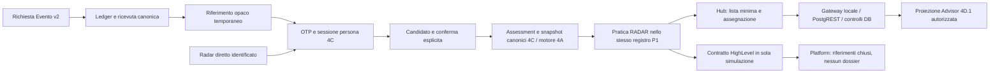

# Radar Patrimoniale — fondazione unica, Fase 5A

Data: 20 ottobre 2026. Esito: **fondazione locale implementata; NO-GO per apertura pubblica e attivazione operativa**. Sono stati realizzati codice, UI Hub, contratti, test e una migration candidata. Nessun push, merge su main, deploy, invito, email reale, modifica di flag remoto, migration remota o scrittura HighLevel.

## Repository, isolamento e SHA

Tutti i nuovi worktree sono sul branch locale `codex/radar-patrimoniale-hub-5a`, in copie Git indipendenti, senza hardlink ai repository originali:

```text
C:/Users/emanu/.codex/visualizations/2026/10/18/01a14e5a-6067-71a0-a210-f3859cab8329/fase-5a/worktrees/website
C:/Users/emanu/.codex/visualizations/2026/10/18/01a14e5a-6067-71a0-a210-f3859cab8329/fase-5a/worktrees/hub
C:/Users/emanu/.codex/visualizations/2026/10/18/01a14e5a-6067-71a0-a210-f3859cab8329/fase-5a/worktrees/platform
```

| Repository/riferimento | SHA iniziale verificato | SHA locale del codice 5A |
| --- | --- | --- |
| Website, public pilot locale | `33724abcfc04ebf6b073f14cf5039948a83a4cb4` | `0d47bad21c16fbe3d1c54c347fb63a97fbf8bab9` |
| Website, origin/main | `9146f6372b19fdac6db1770d05f6b0ca10c1f1e5` | Nessuna modifica a main |
| Website, fonte P1/P2B/P3 selettiva | `3f05f2ef19cff7948815555a5809978070a9dea3` | Importazioni documentate, nessun merge indiscriminato |
| Hub, origin/main | `fa8753462b80f5a75409b6da50caeeda71562ece` | `f9b401642c249aecacbd4a817dd0d4aaa1322071` |
| Platform, origin/main | `8d1cd6c79f3869b3e783d63370d11d772b548ab5` | `3c885eb87b5aa2e80413c5cd0d2571dcf2a96fc5` |

Il commit documentale di questo report segue il commit codice Website indicato: il suo identificativo è l’HEAD finale consegnato, senza riferimenti circolari nel documento.

Il controllo finale degli originali confronta HEAD, branch, diff tracciato, inventario e hash dei **2.772 file non tracciati** Website. Esito invariato. Invariati anche Hub/Platform originali, il worktree Radar `ac56a874ef6a7aefb948c45c738ea9df4b91e0ca` e il public pilot `33724ab` con i suoi due documenti non tracciati. I lock Git Hub/Platform preesistenti, vuoti e risalenti al 20 settembre, sono conservati. Nessun reset, stash, clean o commit del lavoro concorrente. [Evidenza](foundation-5a-evidence/workspace-preservation.json).

### Avanzamenti concorrenti rilevati alla chiusura

La rilettura remota ha trovato Website main ancora a `9146f63` e Hub main ancora a `fa87534`, ma:

- Il branch funnel è avanzato a **`cc15e5d0731a8227eac2a3df39d7e7b0e2242ac3`**, introducendo CV PDF obbligatorio nella candidatura Architetto, upload, retention e migration bucket. Tocca anche `src/components/patrimonial-lead-form.tsx` e `src/lib/public-leads/handler.ts`, modificati dalla 5A. **Non integrato automaticamente**: il futuro consolidamento deve conservare CV, validazioni e finalità recruitment insieme al collegamento Event-only. Questa integrazione è sospesa; non pubblicare la 5A come sostituzione dell’ultimo funnel.
- Platform main è avanzato a **`65434b50caa16212d47b14202445472a1ca58de8`** con branding/account picker e UI/test della casella email. Nessun overlap con i tre file contratto Radar; la regressione completa qui documentata resta riferita alla base `8d1cd6c`, non certifica il nuovo main.

Sono stati acquisiti e confrontati soltanto gli oggetti nelle copie Git isolate; nessun rebase o merge automatico. [Provenienza](foundation-5a-evidence/source-provenance.json).

## Architettura effettiva



Il prodotto finale ha **una sola route identificata**. Il selettore 5A rifiuta i vecchi flag `PUBLIC_ANONYMOUS`; non è stata modificata la Preview storica 4P. Il runtime identificato rimane intenzionalmente locale, default OFF ed escluso su Vercel/Production. Non basta cambiare un flag per aprirlo al pubblico.

Non esistono un secondo motore, un secondo archivio finanziario Hub o persone create a ogni compilazione. Restano la persona UUID e l’indice email HMAC 4C.1, revisioni delle risposte, snapshot canonici approvati, proiezione cliente e Advisor 4D.1. Le compilazioni multiple conservano lo stesso UUID persona.

Il catalogo di 40 domande (29 ordinarie e 11 approfondimenti) e i controlli semplificati già presenti sono riutilizzati; la metodologia e il motore 4A non sono riscritti.

### Modello e autorità

| Oggetto | Autorità e comportamento |
| --- | --- |
| Persona/email/sessione | 4C.1; possesso della casella verificato nel percorso OTP. Non certificazione anagrafica. Email dichiarata nel funnel distinta dalla verifica. |
| Assessment/report | Tabelle private 4C, revisioni CAS e snapshot immutabili; nessuna copia delle risposte in Hub/Platform. |
| Informativa | Ricevuta versionata per assessment `RP-SERVICE-5A-DRAFT-1`, immutabile e separata dal marketing. Creazione/salvataggio/completamento richiedono la ricevuta. Una bozza preesistente può riprendere solo dopo riconoscimento esplicito del proprietario, idempotente e controllato da 4C. |
| Pratica Radar-only | Nuovo kind `RADAR` in `public.patrimonial_intents`, con riferimento minimo. Non è una OPPORTUNITY HighLevel: stage, owner remoto, Location/Contact/Opportunity e campi commerciali fittizi sono vietati dal vincolo DB. |
| Assegnazione | Stessi operatori, intent, assignment, journal, eventi e revisione P1. Manuale, riassegnazione, rilascio, capienza, CAS, replay idempotente e storico. Nessun registro parallelo. |
| Invito/riconciliazione | Riferimento casuale 256 bit, hash a DB, validità 24 ore; stati CANDIDATE/VERIFIED/CONFLICT/REVOKED, provenienza, evidenza e storico. Il collegamento a un assessment richiede persona proprietaria e riconciliazione verificata. |
| Collisioni/caselle condivise/cambio email | Registro di review; nessuna normalizzazione di alias, fusione o spostamento automatico di dossier. Un caso noto in review blocca sessioni cliente e lettura finanziaria Advisor. Serve una procedura autorevole di risoluzione, non implementata né simulata come reale. |
| Binding HighLevel | Persona→Location+Contact, candidato iniziale, evidenza, revisione, unicità dei binding verificati e storico. Revoca terminale. Nessun binding reale creato. |
| Permessi staff | Registro vuoto `hub.patrimonial_radar_permissions`; nessun grant ricavato da marketing, ruolo UI o membership di team. Audit interno in schema hub, immutabile. |

La migration candidata **`supabase/migrations/20261020134559_patrimonial_radar_hub_foundation.sql`** è verificata soltanto in PostgreSQL locale. Estende in modo controllato i corpi P1 conosciuti e fallisce se la versione installata non coincide. Le migration storiche importate P1/P2B/runtime/performance non sono riscritte. [Inventario completo dei file](foundation-5a-evidence/changed-files.json).

## Evento → Radar → Hub → assegnazione

1. I componenti reali delle due landing della base integrata inviano `mode` senza `contractVersion`: selezionano ancora il contratto legacy 2A, **non l’acquisizione canonica v2**. Non è stato cambiato questo comportamento né attivato V2. Il collegamento operativo è quindi bloccato finché il passaggio di contratto non viene approvato e verificato, insieme al nuovo CV concorrente.
2. Il ramo v2 prepara il passo Radar **dopo il commit della ricevuta**. Un errore nel passo successivo non falsifica la ricezione e non esegue fallback CRM legacy. La ricevuta resta “richiesta ricevuta”, non registrazione confermata, prenotazione o consulenza.
3. La continuazione usa soltanto `/radar-patrimoniale#event=<opaco>`, senza PII. Il client rimuove il frammento prima del login, lo conserva in memoria e lo invia dopo OTP tramite POST protetto. Il token non autorizza un dossier.
4. Corrispondenza della casella e riferimento producono un candidato; il proprietario conferma esplicitamente. Una discordanza resta CONFLICT, senza merge, lettura di dossier altrui o esposizione delle partecipazioni altrui nella scheda Hub.
5. L’assessment genera una pratica P1 non assegnata. L’Hub legge soltanto metadati minimi e consente assegnazione con revisione attesa. Il report richiede anche permesso Advisor dedicato e assegnazione corrente. La riassegnazione toglie il diritto al precedente operatore.
6. Il piano CRM emette metadati selezionati, senza risposte/importi e con `writes=[]`. Usa identità interna, revisione approvata, binding e revisione P1. Un owner remoto discordante produce riconciliazione, mai sovrascrittura automatica. P2B resta un prerequisito futuro, con mapping/capability verificati.

Il funnel Architetto conserva finalità di candidatura/reclutamento e non genera consulenza patrimoniale. Non si ricostruiscono partecipazioni o transizioni commerciali dalle note. La riconciliazione operativa recruitment→persona richiede un percorso dedicato di evidenza/review: il ponte Event-only non è riutilizzato tacitamente per tale finalità. Lo scenario E verifica questa separazione, non pretende di completare un’integrazione recruitment reale.

## Hub, Platform e sicurezza

Hub ha panoramica, elenco con ricerca/ordinamento/filtri, scheda persona, report versionati e vista Advisor, assegnazione/riassegnazione/rilascio e storico. La lista non espone importi o risposte. Le risposte tardive vengono scartate dopo un cambio di contesto e il report viene rimosso dalla vista durante aggiornamenti/riassegnazioni.

I server function Hub riutilizzano i middleware CSRF/bearer esistenti. Il gateway è limitato al loopback, richiede Origin e header dedicato, schema JSON chiuso e body limitato. Risposte private/no-store. PostgREST verifica firma/ruolo del JWT locale; la funzione DB controlla uid, sessione Auth corrente, utente attivo, grant corrente e, per Advisor, operatore/assegnazione P1. Le decisioni sono ripetute nel DB, non affidate a componenti nascosti. Le tabelle private, grant e audit non hanno accesso diretto anon/authenticated; RLS FORCE e privilegi minimi. Il ristretto entry point staff SECURITY DEFINER ha search_path fisso e nessun EXECUTE PUBLIC.

Revoche concorrenti, replay/CAS, immutabilità e persone segnate come eliminate sono testati. Una persona eliminata non compare nella coda e il precedente responsabile non può leggerne il report. Ciò non è una procedura completa di cancellazione o una promessa di erasure certificata.

**Limite identità reale:** JWT, utenti Auth, sessioni e grant delle prove sono fixture sintetiche dichiarate. Non dimostrano una identità staff reale, un issuer/JWKS aziendale, una delega di accesso Horyzon o un tenant Platform. I database/progetti Auth dei tre prodotti non vengono presunti coincidenti. Serve provisioning/revoca autorevole con mapping staff→operatore e verifica delle capability/schema reali.

**Limite scheda persona:** 4C conserva HMAC email, non indirizzo in chiaro/nome anagrafico. La scheda mostra lo stato di possesso verificato della casella e i riferimenti, non inventa un profilo identificativo. Contatti consultabili dagli incaricati, eventuale cifratura e cambi email necessitano contratto e gestione dei diritti approvati.

Platform aggiunge soltanto lo schema Zod chiuso `patrimonial-radar-reference-5a-1` e test. Il pianificatore Website è verificato contro quello schema compilato; il tenant context e i ruoli DB Platform restano invariati. Non sono introdotti endpoint, archivi persona o report patrimoniali in Platform.

## Verifiche eseguite

Dettagli e comandi nei [risultati](foundation-5a-evidence/results.json). Nessun risultato di volontari o test remoto di produzione viene inventato.

| Verifica | Esito e limite |
| --- | --- |
| Website | 34 comandi di regressione PASS: Radar, proiezioni, Advisor/accessi/linking/UI/backend, funnel/ledger/CRM/opportunità/persistenza/mapping, P1/P2B/readiness, presentazione Evento/Architetto, prodotti esistenti, typecheck, lint, build. Warning lint preesistenti restano visibili. |
| Backend 4C storico | 14 gruppi PASS su PostgreSQL WASM/PGlite: OTP simulato, sessioni, owner-only, CSRF/cookie/Origin, restore, CAS e ACL. **Non prova nativa multi-connessione**. |
| Fondazione 5A nativa | 13 gruppi PASS su **PostgreSQL 17.6 Windows nativo**, incluse transazioni reali e concorrenza: scenari A–G, ripresa bozza dopo informativa, capienza, CAS/replay, revoca/riassegnazione, binding/history, revoca concorrente, RLS e persona eliminata. |
| PostgREST | **16.5 nativo locale**, 4 gruppi PASS: firma/ruolo/sessione, minimizzazione e permessi separati, accessi diretti negati, gateway/CSRF/Origin, revoca e audit immutabile. **Nessuna prova di identità/grant di produzione**. |
| Contratto Website→Platform | PASS: output effettivo accettato dallo schema Platform, campi finanziari aggiuntivi rifiutati/non proiettati, revisione P1 inclusa nell’idempotenza, nessuna scrittura. |
| Preservazione | PASS: Radar d’Impresa **v4, 34 schermate**, sorgenti/motore preservati, **35 asset fotografici byte-identici**, temi/typography/landing e prove negative di mutazione non autorizzata. |
| Smoke harness | Verificatore sintetico PASS. **CLI live non eseguita**, zero chiamate effettive a provider e zero scritture reali. |
| Hub | 179 test PASS; build PASS; lint dei file nuovi/modificati PASS. Typecheck globale **FAIL: 79 errori identici alla baseline**; lint globale **FAIL: 348 errori e 13 warning identici alla baseline**. Copia baseline separata, nessun aggiustamento di moduli estranei. |
| Platform | Typecheck/lint/build PASS. Suite completa con database nativo e worker limitati: **28 task su 29 PASS**, task customer-web FAIL con **3 test falliti / 93 passati**. I medesimi tre fallimenti si riproducono sulla base `8d1cd6c` (due file: mail-dashboard e portal-activity). Database 30, tenant isolation 255, audit 4 e control-api 375 test PASS. Non certifica il main concorrente `65434b5`. |
| Browser Hub | Componente reale + gateway/PostgREST/SQL locali, fixture dichiarate: PASS desktop 1280×900 e mobile 375×812, diniego prima dell’assegnazione, apertura report, riassegnazione, rimozione report e diniego precedente operatore; scheda/storico consultati. Overflow confinato alla tabella. [Ambito e immagini](foundation-5a-evidence/browser-qa.md). |
| Browser cliente 5A / Auth Horyzon reale | **NOT RUN** come flusso completo su questa revisione. Build, contratti e test HTTP/RPC non sostituiscono il collaudo browser della nuova informativa e del percorso identificato reale. |
| OTP reale, grant reali, CRM reale | **NOT RUN / non attivati**. Nessuna email, credenziale Shared o scrittura remota usata per simulare una prova riuscita. |
| ETag HTML 304 | **FAIL APERTO**, conservato dai report 4P. Non risolto né riqualificato. [Ticket in bozza](human-pilot-4p6/vercel-ticket-draft.md), non inviato. Nessun nuovo deployment o collaudo remoto in questa fase. |

### Aggiornamenti dei verificatori

I vincoli funzionali precedenti restano: sono state sostituite soltanto le aspettative di identità integrale ormai incompatibili con i cambi 5A approvati, mediante hash completi e prove negative. Il core del form rimane confrontato con la baseline; la sola continuazione ammessa è Event-only, dopo ricevuta canonica. I test di presentazione mantengono tema, contenuti, sezioni, asset, accessibilità e layout.

Nel verificatore P2B sono corretti due problemi delle fixture: `undefined` non è un valore rappresentabile sul wire JSON e viene omesso; una prova diretta del decoder lasciava un’operazione in coda prima dello scenario seguente. Restano i dinieghi per omissione senza capability, null non autorizzato, identità discordanti e fencing. Non è stato modificato il worker operativo per ottenere PASS. Il verificatore ledger include ora anche i flag aggiunti da P1/P2B/P3, sempre default false.

Le prove negative che modificano temporaneamente e ripristinano un file vanno eseguite **in sequenza** nello stesso worktree; esecuzioni parallele dei verificatori di preservazione possono produrre falsi FAIL. Gli esiti allegati riflettono le riesecuzioni finali con file ripristinati.

## Riproduzione locale

Requisiti aggiuntivi per i nuovi test: PostgreSQL nativo e PostgREST locali, modulo Node `pg` fornito esplicitamente, ruoli baseline e chiave JWT **di test**. I test nativi rifiutano URL non loopback e qualsiasi database diverso da `radar_5a_test` sulla porta 15439. Il loro helper ricrea esclusivamente gli schemi di quel database sintetico. Non puntarli a un database personale o produttivo. Configurazioni/token locali non sono nei commit.

```text
node --no-warnings --experimental-strip-types scripts/verify-patrimonial-foundation.mjs --pg-module=<percorso-locale-pg>
node --no-warnings --experimental-strip-types scripts/verify-patrimonial-foundation-postgrest.mjs --pg-module=<percorso-locale-pg> --local-config=<config-sintetica-locale>
node --no-warnings --experimental-strip-types scripts/verify-patrimonial-platform-contract.mjs --platform-contract=../platform/packages/contracts/dist/patrimonial-radar-reference.js
node --no-warnings --experimental-strip-types scripts/verify-patrimonial-foundation-preservation.mjs
```

La config PostgREST di test usa soltanto il database locale, gli schemi public/hub e una chiave sintetica. Non copiare issuer, grant o secret di prova in produzione. Le prove Platform hanno usato `TEST_DATABASE_MIGRATOR_URL` loopback, database effimeri `horyzon_test_*` e `turbo run test --env-mode=loose --continue=always --concurrency=2 -- --maxWorkers=2`; nessuna migration remota.

## Readiness e approvazioni ancora necessarie

| Area | Stato prima dell’apertura pubblica |
| --- | --- |
| Sorgenti concorrenti | Riconciliare il nuovo CV Architetto `cc15e5d` nei due file condivisi; aggiornare alla base Platform scelta e rieseguire le relative regressioni. |
| OTP/sessioni pubbliche | Scegliere e verificare provider, credenziali/scopi, callback, rate limit e gestione abusi; collaudare consegna reale, sessioni e revoche. L’adapter 4C attuale accetta soltanto provider simulato e contesto locale. |
| Identità staff | Approvare issuer/audience/JWKS, progetto Auth e mapping staff→operatore P1; provisioning/revoca dei quattro permessi dedicati con prove autorevoli. Nessun ruolo generico deve ampliare il dossier. |
| Dati e migration | Review della candidata contro le versioni/schema reali, privilegi e schema PostgREST, piano di migrazione/backfill/rollback, backup e prova su ambiente autorizzato. Nessuna applicazione remota effettuata. |
| Persona/recruitment | Fonte dei contatti identificativi pertinenti, gestione caselle condivise/cambi email e percorso esplicito di review per correlazioni recruitment. Nessun auto merge. |
| Privacy/editoriale | Approvare finalità/base giuridica, categorie di incaricati, durata di retention, diritti/cancellazione ed eventuale cifratura. La ricevuta Draft non è un consenso marketing o una conformità legale certificata. Distinguere log tecnici di accesso dalle risposte. |
| Hub/Platform | Risolvere o accettare formalmente i fallimenti globali documentati sulle revisioni esaminate; verificare la base corrente e la scala dell’elenco (paginazione/limiti operativi da completare prima di volumi reali). |
| Percorso UI completo | Browser cliente identificato, informativa, OTP reale, multi-compilazione, Event→Radar e Hub con sessioni e assegnazioni reali autorizzate; accessibilità e mobile. Nessun dato personale per le prove preparatorie. |
| HTTP/route/cache | ETag 304 ancora FAIL. Conservare `/radar` d’Impresa; verificare layout isolato, script/telemetria, SEO e navigazione. La policy no-store della home ereditata dal pilot non è modificata in 5A e va deliberata prima dell’integrazione pubblica. |
| HighLevel | Soltanto predisposizione: binding e mapping/capability verificati, contratto minimo approvato, idempotenza e riconciliazione owner via P2B. Mai un dossier finanziario completo nel CRM. |
| Autorizzazione operativa | Nuova autorizzazione esplicita per qualunque push, deployment, migration, flag remoto, invito, email reale o scrittura CRM. |

La fondazione può proseguire in sviluppo e review locale. **Non è pronta per il Radar Patrimoniale pubblico identificato** finché i blocchi sopra non sono risolti. Nessun rilascio o cambiamento dei sistemi in produzione è stato effettuato.
